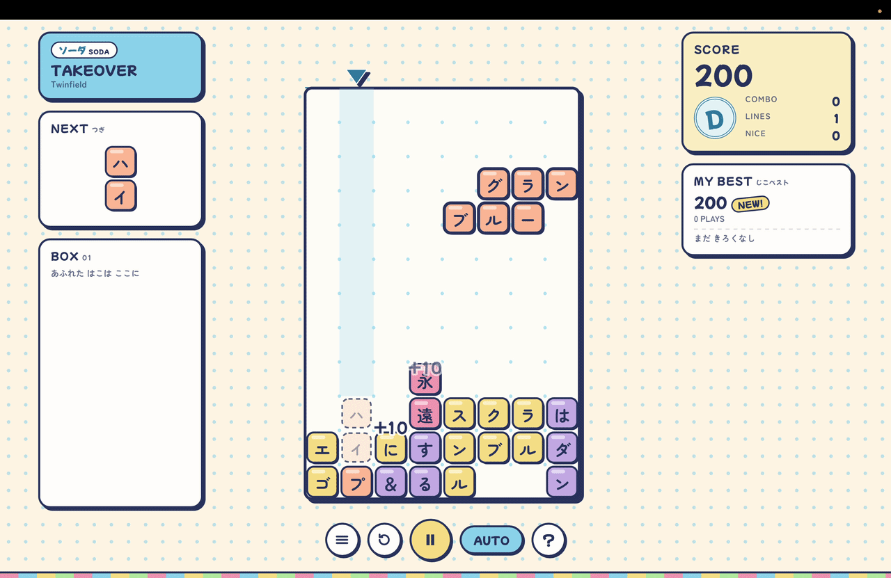

# LyrStack



A lyric-based falling block puzzle game made for the Hatsune Miku Magical Mirai
2026 Programming Contest. Stack the lyrics as they fall, clear lines, and try to
beat your high score!

> Made with the [TextAlive App API](https://developer.textalive.jp/) and Canvas 2D.
> The game runs entirely in your browser, with no backend needed.

## How to play

1. Press PLAY and pick one of the six contest songs.
2. Every sung word drops as a block, move the cursor to aim, and fill a row to clear it.
3. If the stack reaches the top, that box is set aside, you lose points and
   a new box starts.
4. You can drop the lowest block early with a keyboard or mouse. Drop it on
   the beat for a NICE bonus!
5. Feeling lazy? Hit AUTO and enjoy the song (˵ •̀ ᴗ - ˵ ) ✧

## Controls

| Input                        | What it does                          |
| ---------------------------- | ------------------------------------- |
| Space                        | Play / pause                          |
| A S D F / J K L ;            | Jump the cursor to column 1–8         |
| ← →                          | Move the cursor one column            |
| ↓, Enter or click            | Drop the lowest piece                 |
| M                            | AUTO on / off                         |
| ?                            | Help                                  |
| Phone: tap or drag the board | Aim                                   |

## Scoring

| Event                                          | Points                |
| ---------------------------------------------- | --------------------- |
| A piece lands                                  | +10                   |
| Drop on the beat (NICE, keyboard / mouse only) | +25                   |
| Clear 1 / 2 / 3 / 4+ rows at once              | 100 / 300 / 500 / 800 |
| Clearing again with the very next piece        | +50 × combo           |
| Overflow                                       | −500, combo ends      |

- Ranks go from S (best) to D, song length doesn't matter.
- AUTO usually gets around A. S needs clean stacking and multi-row clears.
- Best score, best rank, and the last three runs are saved locally per song.

## Running it

You need [Node.js](https://nodejs.org/) 22.12 or newer and a
[TextAlive app token](https://developer.textalive.jp/profile).

```bash
npm install
cp .env.example .env    # put your token in VITE_TEXTALIVE_APP_TOKEN
npm run dev             # http://localhost:5173
npm run build           # ./docs
```

## Tests

```bash
npm test
npm run lint
npm run audit:deps
npm run check
```

## Project layout

```
lyrstack/
├── index.html              
├── vite.config.js          build settings
├── security.config.js      security headers
├── src/
│   ├── main.js             entry point
│   ├── app/                screen flow
│   ├── config/             settings and songs
│   ├── game/               game logic
│   ├── render/             canvas drawing
│   ├── services/           saved records in local
│   ├── ui/                 HUD and input
│   ├── utils/              helpers
│   └── styles/             CSS
└── tests/
    ├── unit/               game logic
    ├── security/           security checks
    └── helpers/            test tools
```

## Credits

- [Magical Mirai 2026 Programming Contest](https://magicalmirai.com/2026/procon/index_en.html)
- [TextAlive App API](https://developer.textalive.jp/) by AIST
- Songs from the [Magical Mirai 2026 Song Contest](https://piapro.jp/pages/official_collabo/magical2026_musiccontest/result):
  TAKEOVER (Twinfield), Answer Me (imie), After The Curtain (Rulmry),
  Shutter Chance (Yamiagari), The Last March on Earth (Natsuyama Yotsugi × Dopam!ne),
  Toritsukulogy (Tsuruzou)
- Auto Mode for Tetris: [Yiyuan Lee's Tetris AI](https://github.com/LeeYiyuan/tetrisai)
- Fonts: [Zen Maru Gothic](https://fonts.google.com/specimen/Zen+Maru+Gothic) and
  [Mochiy Pop One](https://fonts.google.com/specimen/Mochiy+Pop+One) (SIL Open Font License)

Made with love by Eiffel.
